<p align="center">
  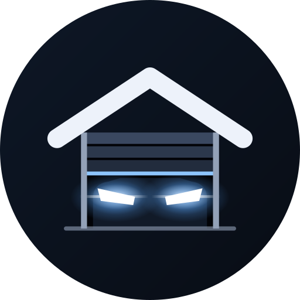
</p>

<h1 align="center">MyGarage</h1>

<p align="center">
  Track every service, upgrade and car wash for your cars, see what you've spent, and know what's due next.<br>
  Native Android · Kotlin · Jetpack Compose · Firebase
</p>

<p align="center">
  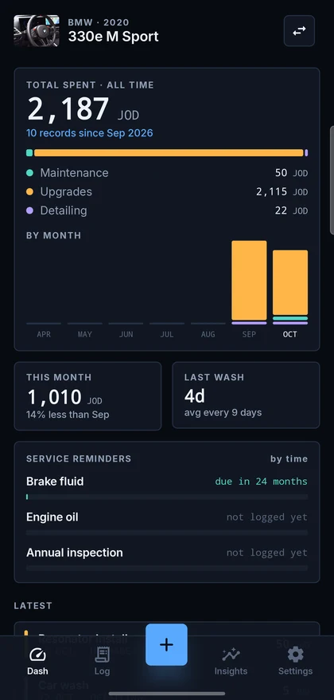
  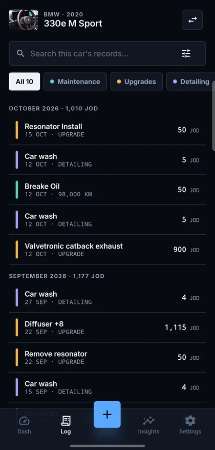
  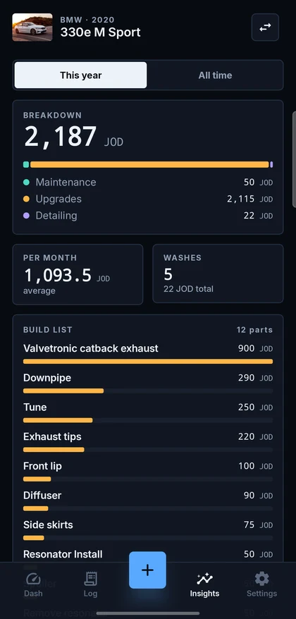
</p>

> **Vibe coded with Claude.** This app was designed and built through conversation with
> [Claude Code](https://claude.com/claude-code) (Anthropic's Claude Opus models). The redesign
> started as clickable HTML mockups, and everything was implemented, run and checked on real
> phones in the same back-and-forth. See [Built with Claude](#built-with-claude) for how.

---

## Contents

- [Features](#features)
- [Screenshots](#screenshots)
- [Architecture](#architecture)
- [Project structure](#project-structure)
- [Design system: Cockpit](#design-system-cockpit)
- [Data model](#data-model)
- [Getting started](#getting-started)
- [Testing](#testing)
- [Releases](#releases)
- [Built with Claude](#built-with-claude)
- [Roadmap and known gaps](#roadmap-and-known-gaps)
- [License](#license)

## Features

**Garage**
- Sign in with Google (Credential Manager), so your data follows your account
- Add several cars with make, model, year, trim, plate, VIN, colour, mileage and a photo
- Pick a car at start; the app remembers it and reopens straight into that car

**Records: three kinds, kept separate**
- **Maintenance** visits (with mileage), **Upgrades** (build list) and **Detailing** (car washes)
- Each record has several items, each split into **parts** and **labour** cost with its own notes
- Workshop, visit notes and a **receipt or photo** attached to the record
- Service names autocomplete from a list that learns your custom entries
- Edit or delete any record; the total and item count stay pinned at the bottom of the form

**Dash**: the picked car at a glance
- **Total spent, all time**, split by type, plus a by-month bar chart
- This month compared with last month, and days since the last wash with the average gap between washes
- **Service reminders by time, not odometer** (oil every 6 months, inspection every 12 …), coloured as on track, due soon or overdue
- Latest records

**Log**
- Full history grouped by month with monthly totals
- Search within the picked car, type chips, and a filters sheet (service, date range, mileage range)

**Insights**
- This year or all time: breakdown by type, average spend per month, wash count and cost
- The **build list**: every upgrade part ranked by cost

**Settings**
- Edit service intervals (months per service)
- Currency; every amount in the app shows it ("35 JOD")
- Sign out, or clear the local garage

**Home-screen widget** (Jetpack Glance)
- One resizable widget: **small** (total and the most urgent reminder), **medium** (total and three reminders), **large** (a mini Dash)
- Refreshes whenever you leave the app and every 3 hours

**Updates**
- An "Update available" sheet when a newer release is out; for releases marked as forced, a non-dismissible "Update required" sheet
- Driven by Firebase Remote Config, which the release workflow updates, so open apps hear about new releases within seconds

**Polish**
- Cockpit dark design system with frosted-glass sticky bars (Haze blur)
- Adaptive launcher icon with a themed (Material You) monochrome layer
- Animated splash screen: the garage's headlights switch on (Android 12+)

## Screenshots

| Garage | Dash | Dash, continued |
|:-:|:-:|:-:|
| 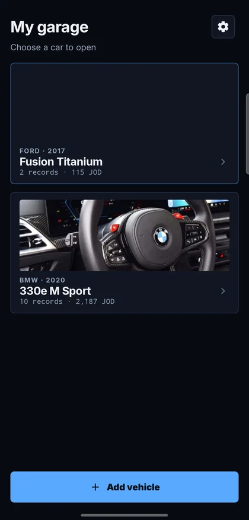 |  | 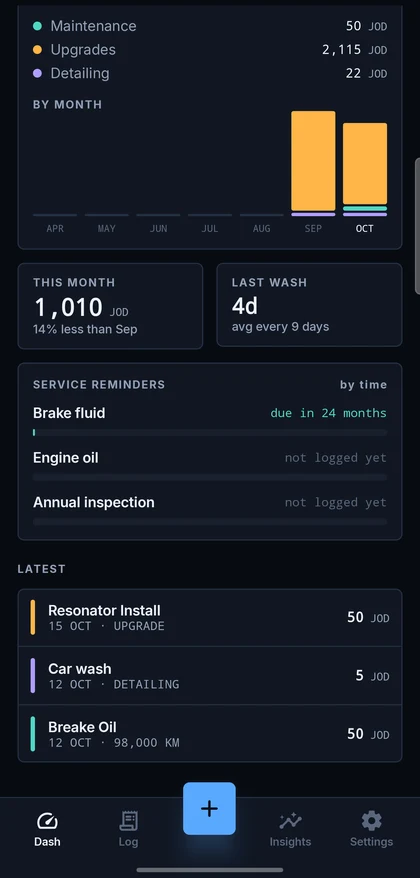 |
| **Log** | **Filters** | **Record detail** |
|  | 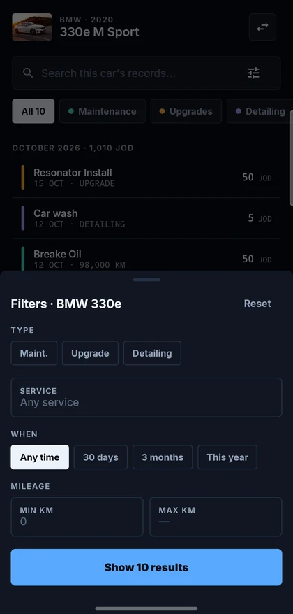 | 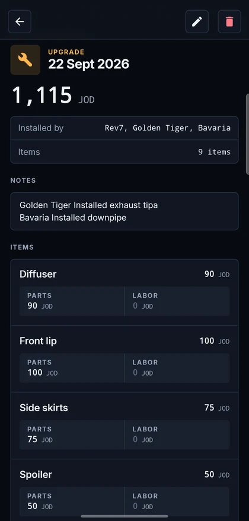 |
| **Add record** | **Insights** | **Settings** |
| 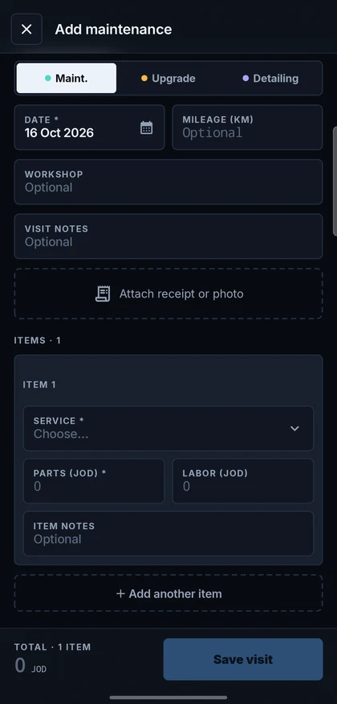 |  | 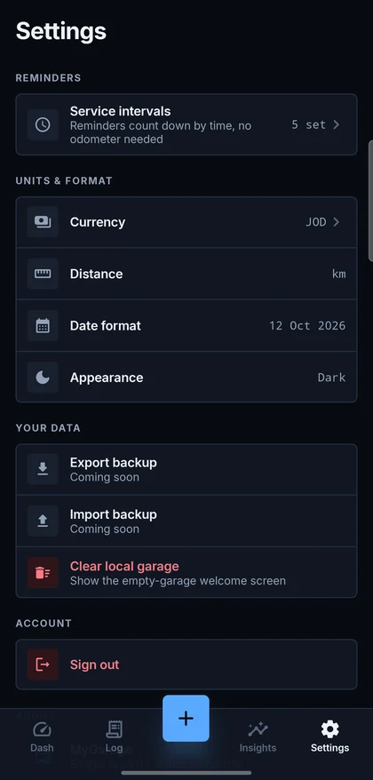 |

**Widget**: small, medium and large

<p>
  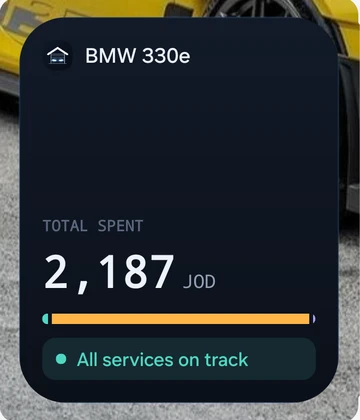
  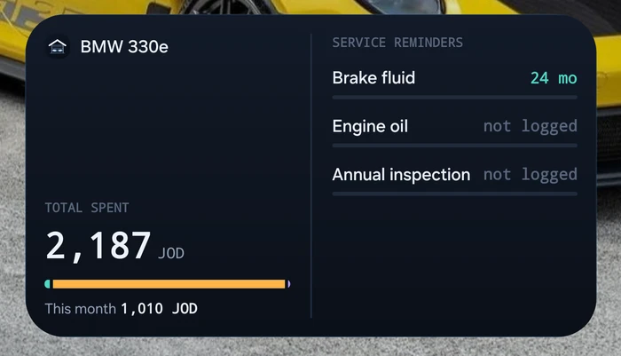
  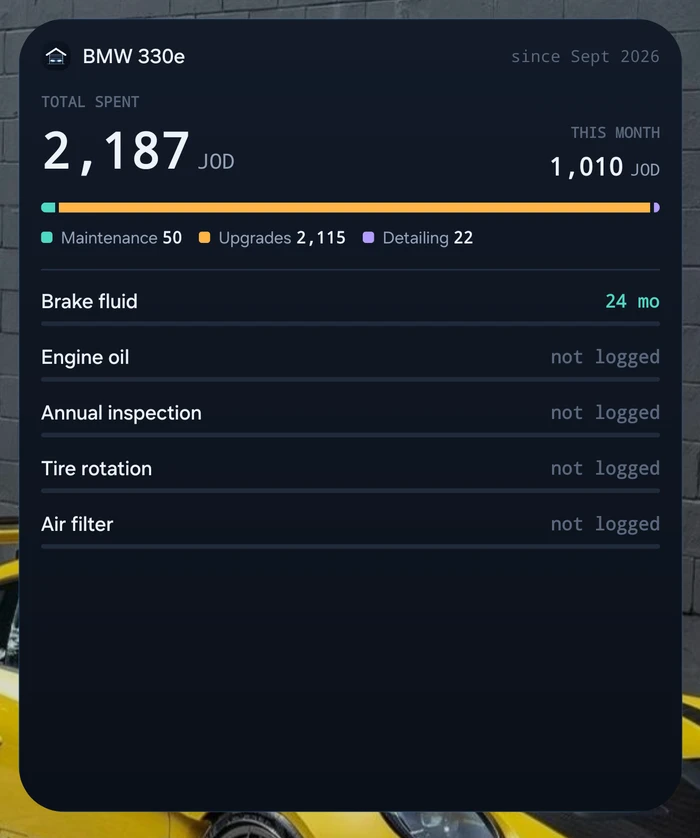
</p>

Screenshots are from a Galaxy S24 Ultra with real data.

## Architecture

A **multi-module, single-activity** app built on these pieces:

| Layer | What it uses |
|---|---|
| UI | Jetpack Compose, Material 3 as a base, custom **Cockpit** design system, Haze for glass blur |
| Presentation | **MVI**: a `State`, `Intent` and `Effect` contract per screen, with ViewModels on a shared `BaseMviViewModel` |
| Navigation | **Navigation 3**: type-safe `NavKey` routes, `entryProvider`, a separate back stack per tab |
| DI | **Hilt** throughout, plus a Hilt `EntryPoint` for the widget |
| Domain | Pure Kotlin models and logic (reminders, spending) and repository interfaces |
| Data | **Firebase Auth**, **Cloud Firestore** (offline cache), **DataStore** for device settings |
| Widget | **Jetpack Glance** |
| Build | Gradle convention plugins in `build-logic`, a version catalog, AGP 9, Kotlin 2.3, R8 |

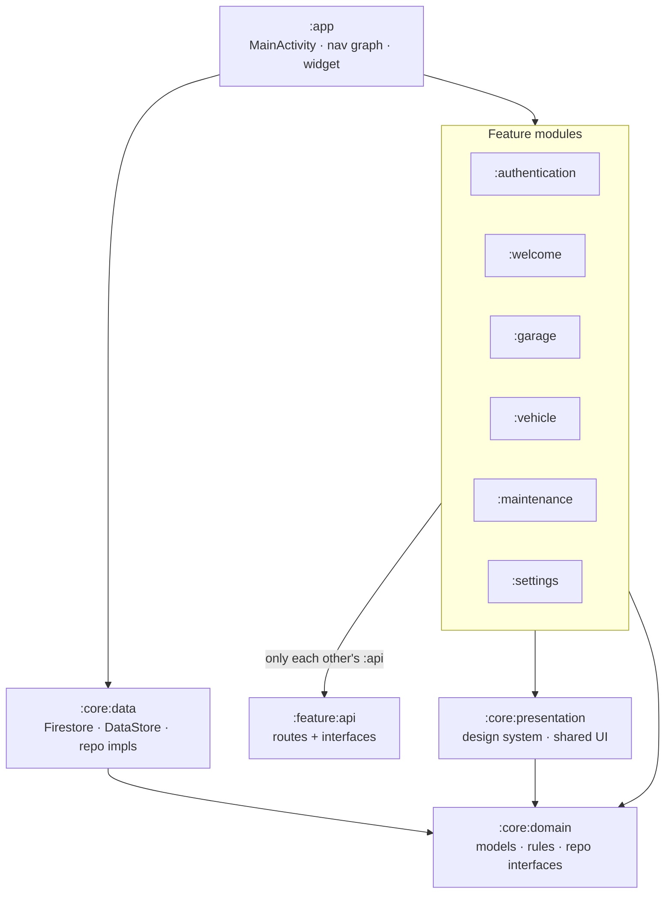

**Module rules**
- A feature depends on another feature only through its `:api` module (routes and interfaces), never its implementation.
- When a feature needs to expose behaviour, it declares an interface in its `:api` and binds the implementation with Hilt `@Binds` inside the feature (for example `SignOutUseCase`).
- Only `:app` depends on feature implementations, because it owns the navigation graph and the DI root.
- Design-system primitives never import `core.domain`. Anything that knows the domain lives in `core.presentation.shared`.

**App flow**: Sign in → Garage (pick a car) → the car's tabs: **Dash · Log · + · Insights · Settings**. The centre **+** opens the add-record form directly.

## Project structure

```
MyGarage/
├── app/                     MainActivity, navigation graph, tab shell, home-screen widget, launcher icon, splash
├── core/
│   ├── domain/              Models (Vehicle, MaintenanceRecord, RecordType…), reminders + spending logic, repo interfaces, unit tests
│   ├── data/                Firestore + DataStore repositories, photo/receipt encoding, Hilt modules
│   └── presentation/
│       ├── components/      Generic slot-based primitives: GarageButton, GarageCard, GarageTextField, GarageTabs, GarageBottomSheet, GarageGlassScaffold…
│       ├── shared/          Domain-aware pieces: Amount + LocalCurrency, RecordRow, RecordTypeTabs, CarVisual, AttachmentField
│       └── theme/           Cockpit tokens: colours, typography, spacing, radius, stroke
├── authentication/ (+api)   Google sign-in, SignOutUseCase
├── welcome/ (+api)          Empty-garage welcome
├── garage/ (+api)           Car picker
├── vehicle/ (+api)          Dash, Log, Insights, car profile, vehicle form
├── maintenance/ (+api)      Add/edit record form, record detail, receipts
├── settings/ (+api)         Service intervals, currency, account
├── resources/               Shared string resources
├── build-logic/convention/  Gradle convention plugins (application, library, feature, core)
├── design/app-icon/         Icon source SVGs and the Play Store PNG
├── docs/screenshots/        README and download-page images
└── site/                    Download page (GitHub Pages)
```

## Design system: Cockpit

Dark only, with the **Ice** palette and **sharp** corners.

| Token | Value |
|---|---|
| Background / surface | `#080B11` / `#111722` |
| Primary (Ice blue) | `#5AA9FF` |
| Text / dim / mute | `#EDF2FA` / `#93A1B7` / `#5A677D` |
| Maintenance · Upgrades · Detailing | teal `#4FD8C4` · amber `#FFB547` · violet `#B39DFF` |
| Good · Warning · Danger | `#4FD8C4` · `#FFC857` · `#FF7A85` |
| Radius | 2–8dp |

Numbers use monospace tabular figures, and every amount is shown with its currency.
The design was worked out as HTML mockups (every screen, every component, app icons and widgets), which are kept outside the repo.

## Data model

Firestore, scoped per signed-in user:

```
users/{uid}
├── vehicles/{vehicleId}                   manufacturer, model, year, trim, plate, vin, color, mileage, photoBase64, createdAt
│   └── maintenance/{recordId}             date, type (Maintenance|Upgrade|Detailing), mileage, workshop, notes,
│       │                                  items[{service, cost (parts), laborCost, notes}], totalCost, hasReceipt, createdAt
│       └── attachments/receipt            data (base64 image), loaded only when opened
└── maintenanceServices/{id}               name, custom   (the autocomplete list)
```

Device settings live in DataStore: the selected car, currency and service intervals.

## Getting started

**Requirements**
- Android Studio with the bundled JBR (JDK 17 or newer), Android SDK 36
- A device or emulator on Android 7.0 (API 24) or newer; the animated splash and themed icon need Android 12 or 13

**1. Firebase**
1. Create a Firebase project and add an Android app with the package name `com.almudier.mygarage`.
2. Download `google-services.json` into `app/`.
3. Turn on **Authentication → Google** and add your debug and release **SHA-1** fingerprints (`./gradlew signingReport`).
4. Put the **Web** OAuth client ID (type 3 in `google-services.json`) in `resources/src/main/res/values/auth.xml` as `google_server_client_id`.
5. Create a **Cloud Firestore** database and lock it to each user:
   ```
   rules_version = '2';
   service cloud.firestore {
     match /databases/{database}/documents {
       match /users/{uid}/{document=**} {
         allow read, write: if request.auth != null && request.auth.uid == uid;
       }
     }
   }
   ```

**2. Build and run**
```bash
./gradlew :app:assembleDebug
```
```bash
./gradlew :app:installDebug
```

**3. Release (optional)**: create `keystore.properties` in the project root. It is git-ignored.
```properties
keystoreFile=mygarage_release.keystore
keystorePassword=…
keyAlias=…
keyPassword=…
```
```bash
./gradlew :app:assembleRelease
```

## Testing

```bash
./gradlew :core:domain:test
```

Unit tests cover the domain rules: time-based reminder states (`RemindersTest`) and spending totals and monthly splits (`SpendingTest`).
Every screen, the widget sizes, the launcher icon and the splash were also checked by hand on a Galaxy S24 Ultra and a Galaxy Note 20.

## Releases

Every merge to `main` publishes a new release automatically ([`.github/workflows/release.yml`](.github/workflows/release.yml)). The workflow:

1. Runs the unit tests.
2. Builds the release APK, signed with the release key.
3. Checks the APK's signature.
4. Creates a GitHub release `v1.1.<run>` with the APK attached and notes generated from the merged pull requests.

The `versionCode` goes up with every run, so each new APK installs over the previous one. Changes that only touch docs or design files (`*.md`, `docs/`, `design/`, `site/`) don't trigger a release. You can also start one by hand from the Actions tab (**Run workflow**).

**One-time setup**: add these in GitHub → Settings → Secrets and variables → Actions:

| Secret | Value |
|---|---|
| `KEYSTORE_BASE64` | The release keystore as base64 (see the command below) |
| `KEYSTORE_PASSWORD` | Keystore password |
| `KEY_ALIAS` | `MyGarage` |
| `KEY_PASSWORD` | Key password |

To copy the keystore as base64 on Windows (PowerShell, from the project root):

```powershell
[Convert]::ToBase64String([IO.File]::ReadAllBytes("mygarage_release.keystore")) | Set-Clipboard
```

The release key's SHA-1 must stay registered in Firebase for Google sign-in to work in these builds.

### Telling installed apps about a release

After publishing, the workflow writes the new version to **Firebase Remote Config**. The app listens to Remote Config in real time and shows a bottom sheet:

| Parameter | Set by | Effect |
|---|---|---|
| `latest_version_code`, `latest_version_name` | every release | Installs below it get **Update available**, which can be dismissed with "Later" |
| `min_version_code` | releases marked as forced | Installs below it get **Update required**, which can't be dismissed |
| `update_url` | every release | The download page that **Download update** opens |

**To force an update:** put `[force-update]` in the PR title (it ends up in the merge commit message), or tick **Force update** when running the workflow by hand.

**One-time setup:**

1. In Google Cloud Console → IAM & Admin → **Service accounts**, create a service account in the Firebase project and give it only the **Firebase Remote Config Admin** role.
2. Create a JSON key for it, then add the whole file's contents as the repository secret `FIREBASE_SERVICE_ACCOUNT`. Delete the downloaded file afterwards.

Without the secret, releases still publish, and the workflow logs a warning that apps weren't told.

### Download page

[`site/`](site) is a one-page download site published with GitHub Pages at **https://khaledymoh.github.io/MyGarage/** ([`.github/workflows/pages.yml`](.github/workflows/pages.yml)). Its button always downloads the newest build: every release also attaches the APK under the fixed name `MyGarage.apk`, so `releases/latest/download/MyGarage.apk` never changes. The page shows the latest version, size and date from GitHub's API.

**One-time setup:** Settings → Pages → Build and deployment → Source: **GitHub Actions**. On GitHub's Free plan, Pages and public release downloads need the repository to be public.

## Built with Claude

MyGarage was built by "vibe coding" with **Claude Code**: the owner described what they wanted and Claude did the design and engineering work in the same conversation.

1. **Explore in HTML first.** Three redesign directions were mocked as HTML. "B · Cockpit" was picked, refined over several rounds of feedback, and given colour and corner-radius variants (Ice + Sharp won).
2. **Design system before screens.** Claude extracted generic, slot-based primitives (Button, Card, TextField, Tabs…) into `:core:presentation` and documented each one in an HTML design-system page.
3. **Implement in phases** on a branch: foundations → primitives → shared compositions → data → navigation → each screen → clean-up. Each phase compiled, ran on a connected phone and was checked from screenshots.
4. **Iterate on device.** Feedback like "make the back button match", "sticky glass toolbar" and "the big widget doesn't show reminders" went straight into fixes that were checked again on the phone.
5. **Branding the same way.** Twelve app-icon concepts as HTML, narrowed down to the "Night Garage", then turned into adaptive-icon vectors, Figma SVGs and an animated splash.

Claude works from local guide files (a `CLAUDE.md` plus short guides for screens, MVI and modules), so later sessions keep to the same architecture. They're kept out of the repo.

## Roadmap and known gaps

- **Export / import backup**: shown in Settings as "Coming soon"
- **Distance unit, date format and appearance** are fixed (km, `12 Oct 2026`, dark). They're shown in Settings but can't be changed yet
- **Localisation**: English only; the app is RTL-ready (`supportsRtl`) but has no Arabic strings yet
- **Mono font**: the system monospace is used. Bundling JetBrains Mono would match the mockups exactly
- **Widget taps** open the app. They could deep-link to the add form for a specific service
- **Receipts** are base64 in Firestore, which works for photos under Firestore's 1 MB document limit. Cloud Storage would scale better
- **Tests**: no UI or instrumentation tests yet. CI runs the unit tests only as part of each release

## License

[PolyForm Noncommercial 1.0.0](LICENSE.md). You may use, study, change and share MyGarage for personal and other non-commercial purposes. Commercial use is not allowed without the author's permission.

Copyright (c) 2026 Khaled Mohammad
